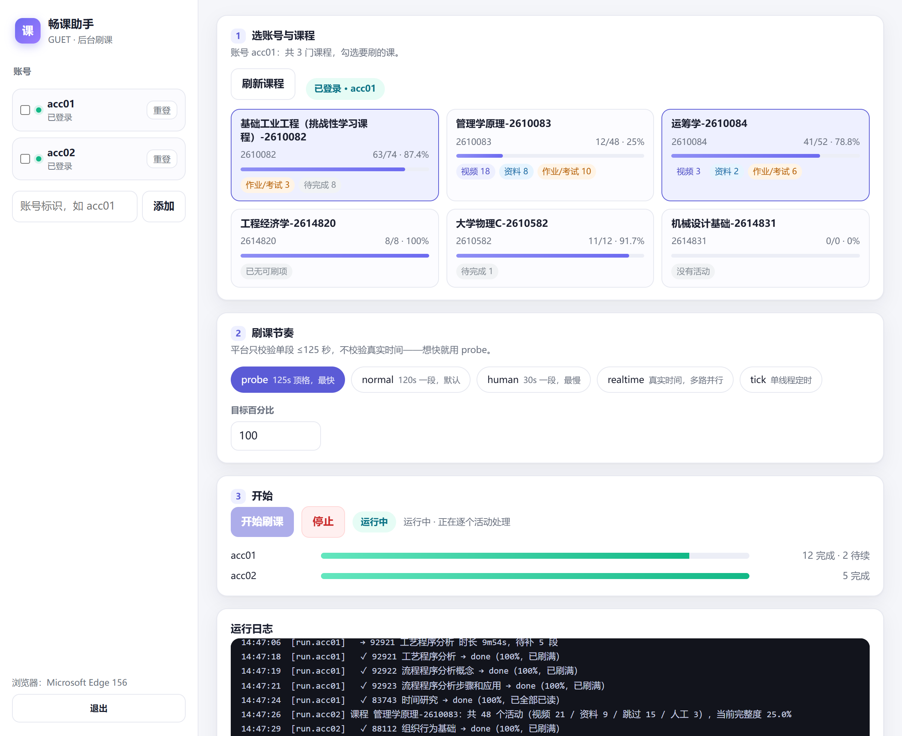

<div align="center">

# GUET 畅课助手

**浏览器后台刷课 · 图形界面 · 装完即用**

[](../../releases)
[](LICENSE)
[](#)



</div>

---

## 这是什么

桂林电子科技大学「畅课（TronClass）」平台的**后台刷课工具**。

不是模拟点击、也不是挂着浏览器慢慢播——它登录后直接调用平台的进度接口，把视频进度按「已看区间」补满：

```http
POST /api/course/activities-read/92918   {"start": 0, "end": 125}
→ {"completeness": 100, "data": {"ranges": [[0,125]]}}
```

一门 5 小时的课，**4 分钟**刷完；资料类（PPT/PDF）按附件逐个标记已读。作业和考试不碰。

## 下载哪个版本

| 版本 | 安装包体积 | 适合谁 |
|---|---|---|
| **完整版** `GuetShuake-<版本>-full-setup.exe` | ≈ 110 MB | **推荐**。内置浏览器内核，装完就能用，不依赖系统里装了什么 |
| **精简版** `GuetShuake-<版本>-lite-setup.exe` | ≈ 38 MB | 电脑里有 Microsoft Edge（Windows 10/11 默认自带） |

两个版本功能完全一样，区别只是「登录用的浏览器内核从哪来」。装完都是双击图标即用，**不需要装 Python、不需要联网下载内核**。

> 卸载只会删程序目录，你的账号、登录状态和刷课进度保存在 `%LOCALAPPDATA%\GuetShuake`，不会被删。

## 三步开始

1. **装好打开** —— 首次启动会自动生成配置，不用手写任何文件
2. **加账号 → 点「登录」** —— 会弹出一个浏览器窗口，微信扫码或 CAS 学号密码都行，登进去就自动关闭
3. **刷新课程 → 勾课 → 开始**

窗口里能实时看到：每个活动的完成情况、两个账号各自的进度条、后台日志。

## 五种节奏

平台对单次上报跨度有硬限制：**≤ 125 秒**（超出会返回 `400 maximum is 125s`）；但它**不校验真实时间**——实测 563.9 秒的视频，5 次请求 17 秒就刷满。

| 节奏 | 段长 | 说明 | 整门课耗时（23 视频 + 18 资料） |
|---|---|---|---|
| `probe` | 125s | 顶格上报，最快 | ≈ 4 分钟 |
| `normal` | 120s | 默认，稳 | ≈ 10 分钟 |
| `human` | 30s | 请求密度低 | ≈ 30 分钟 |
| `realtime` | 120s | 每条视频走真实时间、多路并行 | 4h53m ÷ 并行路数 |
| `tick` | 120s | 单线程定时任务，每 120s 推进一轮 | 同 realtime，但可挂计划任务 |

## 功能

- **多账号**：账号之间并行，一个失效不影响另一个
- **断点续跑**：Ctrl-C、关机、断网都无所谓，下次从断点继续（`data/state.*.json`）
- **自动降档**：服务端拒收大跨度就自动减小段长，一次学会上限
- **会话保活**：cookie 每条响应都轮换，工具自动跟随；失效自动重取
- **全本地**：只跟学校服务器通信，不上传任何数据；界面跑在 `127.0.0.1`，带随机 token 防本机其它程序访问

## 常见问题

| 现象 | 处理 |
|---|---|
| 点「登录」没反应 / 窗口一闪 | 精简版需要系统 Edge；装 Edge 或换完整版 |
| 提示「会话不可用」 | 在界面里点「重登」 |
| 某个活动一直不到 100% | 换 `human` 节奏重试；仍不动就到 `%LOCALAPPDATA%\GuetShuake\logs\gui.log` 看原因 |
| 杀毒软件报警 | 未签名的 PyInstaller 程序常见误报，可加白名单；源码全在这里，可自行构建 |
| 想换数据目录 | `GuetShuake.exe --data-dir D:\MyData` |

## 命令行（高级）

图形界面只是外壳，仓库里同时保留了完整的 CLI：

```powershell
python run.py login --all                 # 登录
python run.py status                      # 看会话与完整度
python run.py run --all --speed probe --gap 0.5   # 极速刷
python run.py bench --account acc01 --course 29066  # 实测延迟并推荐并行路数
python run.py schedule --account acc01 --every 2 --install  # 每 2 分钟跑一轮的计划任务
python start.py                           # 终端版向导
```

参数、接口清单、算法细节见 **[docs/TECH.md](docs/TECH.md)**。

## 代码签名

旧版安装包使用**自签名证书**，其他电脑不默认信任。Windows 11「智能应用控制」可能直接阻止运行，不能套用 SmartScreen 的「更多信息 → 仍要运行」说明。导入开发证书也不是跨电脑发布方案。

正式发布需要受信任的代码签名证书或服务，签署应用和安装包并附时间戳。签名可验证发布者，但**不能保证 SmartScreen 信誉、智能应用控制和企业策略全部无提示放行**。未配置正式证书时，CI 禁止发布 Release，只能生成开发测试产物。

配置及验收见 **[签名与跨电脑运行](packaging/SIGNING.md)**。`full` 内置浏览器解决运行依赖问题，不会赋予签名信任。`SHA256SUMS.txt` 用于核对下载完整性，不能替代发布者验证：

```powershell
Get-FileHash .\GuetShuake-1.0.0-full-setup.exe -Algorithm SHA256
```

## 自己构建

```powershell
python -m pip install -r requirements.txt pyinstaller
python -m playwright install chromium          # 完整版需要，复制到 packaging\browsers
powershell -ExecutionPolicy Bypass -File packaging\build.ps1            # full + lite
powershell -ExecutionPolicy Bypass -File packaging\build.ps1 -Variant lite
```

产物：`dist\full|lite\GuetShuake\GuetShuake.exe`，安装包在 `packaging\output\`。

需要 [Inno Setup 6](https://jrsoftware.org/isdl.php)（脚本会自动在注册表里找 `ISCC.exe`）。

## 项目结构

```
main.py                 GUI 入口（打包用）
run.py / start.py       命令行入口 / 终端向导
guet/
  gui/                  本地 HTTP + Edge --app 窗口 + 单文件前端
  session.py            登录、cookie、传输层
  client.py             TronClass 接口封装
  runner.py             执行器（视频分段 / 资料已读 / 断点续跑）
  realtime.py ticker.py 真实时间多路 / 固定节拍
  scheduler.py          多账号编排、课程缓存、账号锁
  benchmark.py          延迟实测 + 并行路数推荐
packaging/              图标、PyInstaller spec、Inno Setup 脚本、构建脚本
tests/                  83 项离线测试（不联网）
docs/TECH.md            接口清单与实现细节
```

## 测试

```powershell
python -m unittest discover -s tests -q      # 83 项，全部离线
```

## 免责声明

仅供个人学习研究使用。使用本工具产生的任何后果（包括但不限于成绩认定、学术诚信处理）由使用者自行承担，作者不承担任何责任。请遵守学校相关规定。

## License

[MIT](LICENSE)

## 发布到 GitHub

本仓库：<https://github.com/chushengzhink/guet-shuake>

发新版本的流程：

```powershell
git add -A; git commit -m "feat: ..."; git push

# 正式构建：先安全设置 GUET_CODESIGN_PASSWORD 环境变量
powershell -ExecutionPolicy Bypass -File packaging\build.ps1 -Variant both -Version 1.0.1 -Release -Sign -SignMode pfx -PfxPath C:\certs\codesign.pfx

# 打 tag 并把安装包挂上 Release
gh release create v1.0.1 packaging\output\GuetShuake-1.0.1-*.exe packaging\output\SHA256SUMS.txt `
  --title "v1.0.1" --notes "更新说明"
```

> tag **不会**自动触发 CI：这样本地验证过的签名包不会被 CI 产物覆盖。
> 想用 CI 出包，到 Actions → `build-release` → Run workflow（勾选 publish）。

仓库里的开发证书仅供本地测试，不是公开发行的信任凭据。
